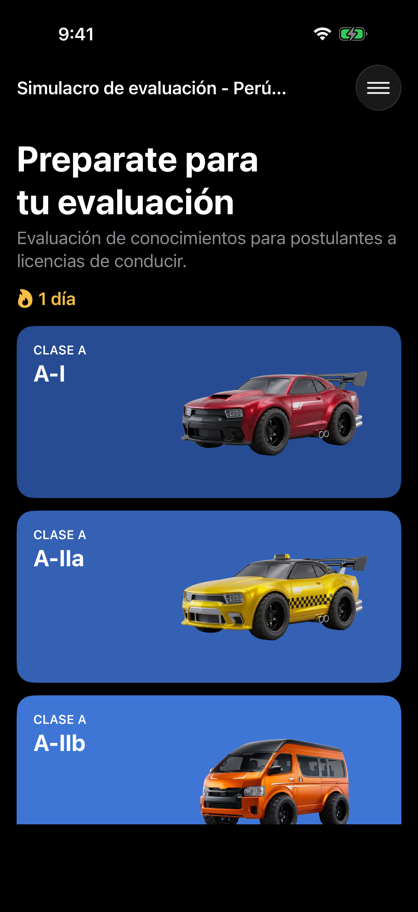
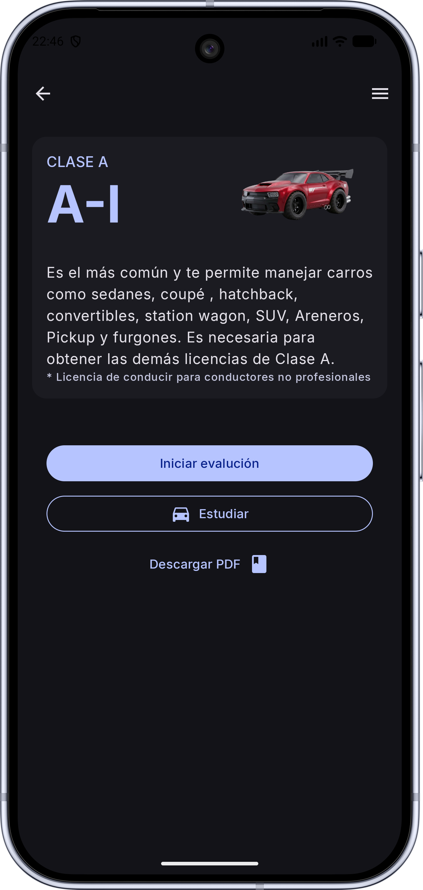
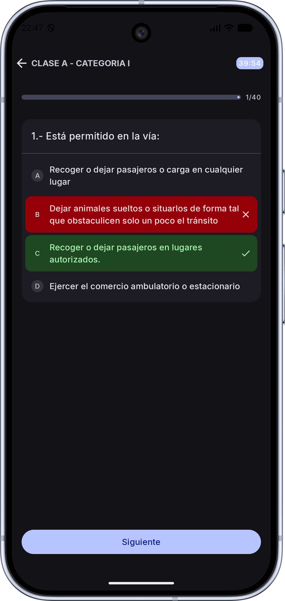
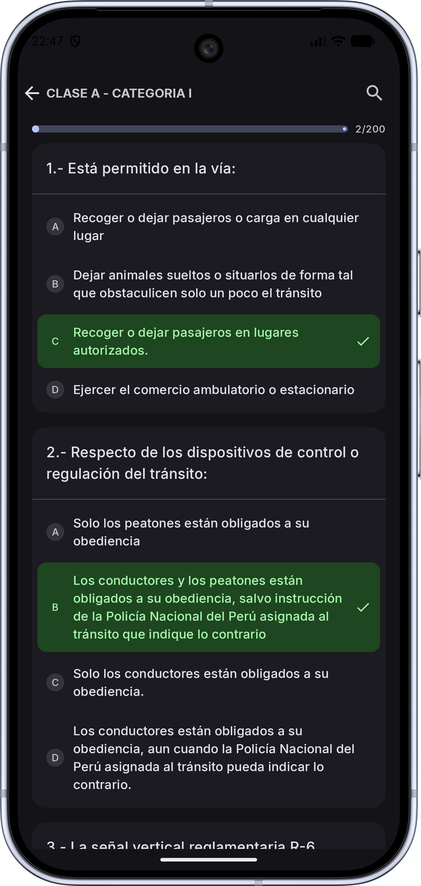
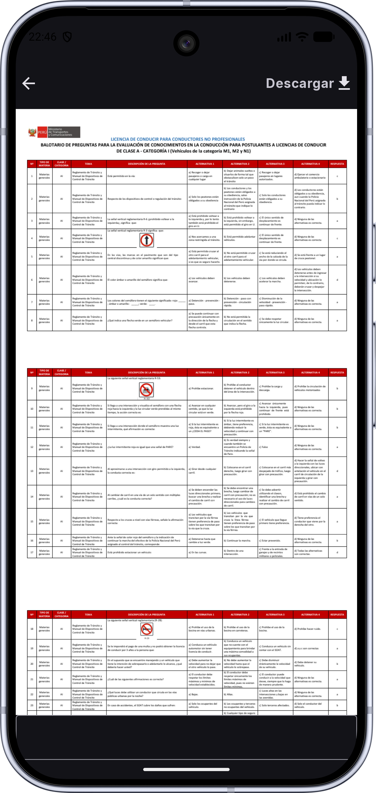
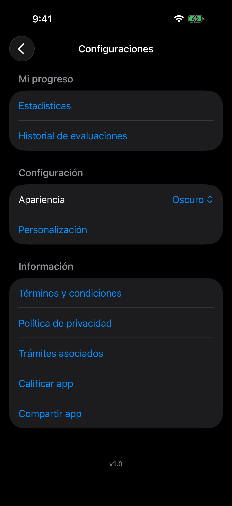

# MTCQuiz


MTCQuiz es una app nativa de iOS para practicar el examen de licencia de conducir del MTC (Ministerio
de Transportes y Comunicaciones del Perú). Trae los nueve bancos de preguntas oficiales como JSON e
imágenes empaquetados, para que quien estudia pueda hacer simulacros cronometrados, recorrer todo el
banco de preguntas con retroalimentación instantánea, y ver el PDF oficial del balotario — todo sin
conexión, sin cuenta y sin backend.

Es la contraparte en iOS de una app Android existente (`gonzalo-droid/mtc-quiz`), reconstruida de
forma nativa en SwiftUI en vez de portada línea por línea, y mantenida en paridad de comportamiento
con ella sobre una base de mejor esfuerzo.

## Capturas

| | | |
|:---:|:---:|:---:|
|  |  |  |
| **Inicio** | **Detalle de categoría** | **Evaluación** |
|  |  |  |
| **Estudiar** | **PDF del balotario** | **Configuraciones** |

## Funcionalidades

| Funcionalidad | Detalle |
|---|---|
| Nueve categorías de examen | A-I, A-IIa, A-IIb, A-IIIa, A-IIIb, A-IIIc, B-IIa, B-IIb, B-IIc — un banco de preguntas cada una, empaquetado como JSON + imágenes, copiado tal cual del PDF oficial del balotario del MTC (incluidas sus erratas de imprenta; un banco nunca se "corrige" contra otro) |
| Evaluación cronometrada | Duración, número de preguntas y porcentaje de aprobación configurables (por defecto: 40 minutos / 40 preguntas / 80%, igual que Android); cada respuesta se califica al instante con resaltado verde/rojo, y el intento terminado se puntúa y se guarda |
| Resumen, historial y estadísticas | Un resumen de aprobado/no aprobado por intento, un historial de evaluaciones pasadas, estadísticas agregadas, y una revisión de "errores más frecuentes" a partir de intentos anteriores |
| Estudiar | Recorre el banco completo de una categoría (hasta 200 preguntas) con búsqueda que ignora tildes; las respuestas correctas se muestran en línea y no hay cronómetro |
| Visor del PDF del balotario | Visor de PDF integrado para el examen oficial de la categoría, con descarga por hoja de compartir a cambio de un anuncio con recompensa (si no hay anuncio disponible, la descarga es directa) |
| Configuraciones | Tema (sistema / claro / oscuro), duración/número de preguntas/porcentaje de aprobación de la evaluación, estadísticas, historial de evaluaciones, y enlaces a Términos, Política de Privacidad y la página oficial de "Trámites asociados" |
| Onboarding | Introducción deslizable de tres páginas, se muestra una sola vez en el primer arranque |
| Racha | Contador "🔥 N día(s)" en Inicio una vez completada al menos una evaluación |
| Anuncios | Banner de Google Mobile Ads en Inicio/Detalle y uno cada 10 preguntas en Estudiar, un intersticial con contador al iniciar una evaluación (cada 3ra vez) y un anuncio con recompensa al descargar un PDF; los builds de Debug usan las unidades de prueba públicas de Google para que el desarrollo nunca sirva impresiones reales |
| Premium | Stub de paywall solo de interfaz. `PremiumViewModel.subscribe()` es un no-op, no hay planes reales, y `isPremiumUser()` está fijo en `false` — no hay integración de StoreKit todavía. Sus puntos de entrada (la corona de Inicio, la fila de Configuraciones, el upsell "¿Cansado de los anuncios?" tras un anuncio, la opción Premium de la descarga del PDF) están **ocultos** hoy detrás de un flag de build (`offersPremium = false` en `mtcquizApp.swift`), así que la pantalla del paywall en sí no es alcanzable desde la app en ejecución |

## Stack tecnológico

| | |
|---|---|
| Lenguaje | Swift 5 |
| UI | SwiftUI, view models con `@Observable` (no `ObservableObject`/Combine) |
| Persistencia | SwiftData (historial de evaluaciones, preguntas descartadas) + `UserDefaults` (ajustes de evaluación) + `@AppStorage` (tema, flag de onboarding) |
| Navegación | Un único `NavigationStack` + `NavigationPath`, con un enum `Route` para cada destino |
| Modularidad | Paquetes locales de Swift Package Manager, uno por capa/feature, cada uno con su propio scheme de Xcode — el target de la app solo contiene el composition root |
| Anuncios | Google Mobile Ads SDK 12.14.0 (banner, intersticial y con recompensa). Google User Messaging Platform 3.1.0 para el formulario de consentimiento |
| Tests | Swift Testing (`@Test`, `#expect`, `@Test(arguments:)`), fakes escritos a mano sobre los protocolos de `MTCDomain` — sin framework de mocking |
| Backend | Ninguno — sin servidor, sin Firebase, sin login. Todo el contenido va empaquetado dentro de la app |

## Arquitectura

Clean Architecture, un paquete local de SPM por capa o feature. Las dependencias apuntan hacia
adentro (features → `MTCDomain`, más `MTCDesignSystem` para la UI); nada depende de un paquete de
feature.

```
mtcquiz/                     Target de la app (deliberadamente delgado)
├── mtcquizApp.swift          Composition root — construye cada repositorio y el ads manager
└── Route.swift               Cada destino de la app, como un único enum

Packages/
├── MTCDomain/                 Modelos (Question, Category, Evaluation, SubscriptionPlan) y
│                              protocolos de repositorio — Swift puro, sin UI, sin I/O
├── MTCData/                   Repositorios (preguntas, categorías, preferencias, SwiftData) +
│                              el JSON y las imágenes de los bancos de preguntas empaquetados
├── MTCDesignSystem/            MTCColor, MTCTypography, y vistas compartidas (AnswerOptionRow,
│                              QuestionAnswerCard, QuestionImageStrip, VehicleIllustration,
│                              LegalWebView)
├── MTCHomeFeature/ MTCDetailFeature/ MTCEvaluationFeature/ MTCQuestionReviewFeature/
│   MTCPDFFeature/ MTCSettingsFeature/ MTCPremiumFeature/ MTCOnboardingFeature/
│                              Una pantalla (vista + view model) por paquete de feature
└── MTCAdsFeature/              GoogleAdsManager — envuelve los banners, el intersticial y el anuncio con recompensa
```

La inyección de dependencias es manual y explícita: `mtcquizApp` construye cada repositorio una sola
vez y los pasa hacia abajo como parámetros de `init`. No hay contenedor de DI ni grafo de
`@EnvironmentObject`.

## Requisitos y puesta en marcha

| Herramienta | Notas |
|---|---|
| Xcode | Compila con el Xcode instalado en la máquina; el proyecto no declara una versión mínima |
| iOS | 17.0+ (deployment target) |
| Swift | Language mode 5 |

No hace falta ninguna API key, `GoogleService-Info.plist` ni configuración de backend — la app no
tiene Firebase ni servidor. Los ids de unidad de AdMob están fijos en `mtcquiz/mtcquizApp.swift`
(las unidades de muestra públicas de Google bajo `#if DEBUG`, las reales en Release), así que un
clon recién hecho compila y corre sin ningún paso de configuración.

```bash
# Descubre los nombres reales de scheme y destino en vez de adivinarlos
xcodebuild -list -project mtcquiz.xcodeproj
xcrun simctl list devices available

# Compilar un paquete
xcodebuild build -scheme MTCDesignSystem \
  -destination 'generic/platform=iOS Simulator' -derivedDataPath /tmp/mtcds-verify

# Testear un paquete — siempre vía xcodebuild, nunca `swift test` directo
xcodebuild test -scheme MTCSettingsFeature \
  -destination 'platform=iOS Simulator,name=iPhone 17'
```

Nada se compila "a nivel de app": cada paquete compila y se testea por separado, con su propio
scheme (`xcodebuild test` — `swift test` a secas falla porque los paquetes apuntan al SDK del
simulador de iOS). Todos los paquetes tienen tests salvo `MTCOnboardingFeature`.

## Versionado

Versión actual: **1.0** (build 1)

Este repositorio todavía no tiene `CHANGELOG.md`. El trabajo previo a la subida a la App Store (ícono
de la app, manifiesto de privacidad, declaración de export compliance, identificador de SKAdNetwork)
ya está listo, pero la app aún no tuvo su primera versión pública — su ficha en App Store Connect
existe pero no resuelve públicamente hasta que salga ese primer lanzamiento.

## Privacidad

- [Términos y condiciones](https://gonzalo-lozg.me/apps-docs/mtcquiz/term/)
- [Política de privacidad](https://gonzalo-lozg.me/apps-docs/mtcquiz/politics/)

Al primer arranque, antes de cargar anuncios, la app muestra el formulario de consentimiento de
Google (UMP, para usuarios del EEE, Reino Unido y Suiza) y luego el aviso de App Tracking
Transparency. Si el usuario no da permiso, AdMob sirve anuncios no personalizados.

Según el `PrivacyInfo.xcprivacy` de la app, el código propio no rastrea ni recolecta datos (todo
queda en el dispositivo), y su único uso de API declarado es leer/escribir `UserDefaults` para sus
propios ajustes. Quien rastrea es Google Mobile Ads: su propio manifiesto declara el identificador
del dispositivo como dato de rastreo, junto con lo demás que el SDK recolecta para publicidad.

## Licencia

Copyright © 2026 Gonzalo Lozg. Todos los derechos reservados.

Este código fuente es propietario. Puede consultarse como referencia, pero no puede copiarse,
modificarse, redistribuirse ni publicarse en ninguna tienda de apps sin permiso escrito.

El contenido oficial del examen del MTC (bancos de preguntas y PDFs del balotario) pertenece al
Ministerio de Transportes y Comunicaciones del Perú. La licencia anterior cubre solo el código
fuente de esta aplicación, no ese contenido de terceros.
